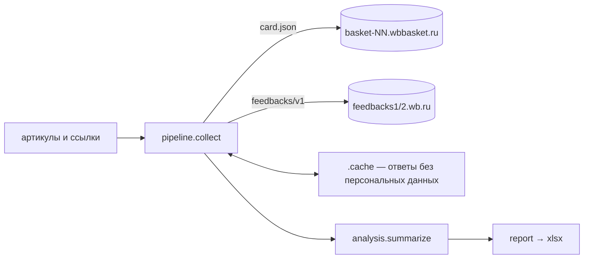

# wb-reviews-report — отзывы конкурентов на Wildberries → отчёт в Excel

Селлер вводит артикулы или ссылки на товары конкурентов, а в ответ получает Excel-отчёт. Из него видно, растёт ли у товара доля негатива, на что жалуются покупатели, маломерит ли вещь и как быстро продавец отвечает на плохие отзывы. Данные берутся из публичных JSON-адресов WB — без ключей API и без браузера.

```text
$ wb-reviews demo -o examples/отчёт-демо.xlsx

101000001 · Платье миди из вискозы с поясом — рейтинг 4,4, отзывов: 1 400
  • Негатив растёт: 22% оценок 1–2 за 30 дней против 7% за 90 дней до этого.
  • Чаще всего жалуются: «Размер и посадка» — 66 из 162 жалоб с текстом.
  • Маломерит: так отметили 17% из 340 покупателей, указавших посадку.
  • Продавец отвечает только на 22% отзывов на 1–3.
  • WB отдал не все отзывы (всего 1 400) — в анализе отзывы с 22.02.2026.

101000002 · Кроссовки беговые с амортизацией — рейтинг 4,5, отзывов: 630
  • Доля оценок 1–2 стабильна: 5% за 30 дней.
  • Чаще всего жалуются: «Качество и брак» — 34 из 81 жалобы с текстом.
  • Продавец отвечает почти на все отзывы на 1–3 (100%), медиана ответа — 5 ч.

101000003 · Термокружка 450 мл с крышкой-поилкой — рейтинг 3,9, отзывов: 816
  • Негатив снижается: 8% оценок 1–2 за 30 дней против 26% за 90 дней до этого.
  • Чаще всего жалуются: «Качество и брак» — 189 из 240 жалоб с текстом.

Отчёт: examples\отчёт-демо.xlsx — 3 товара
```

Демо-товары синтетические, у каждого своя история. У платья новая партия «села» в размер, у кроссовок всё стабильно и продавец отвечает на каждую жалобу, у термокружки поменяли протекавшую крышку. Готовый отчёт лежит в [`examples/отчёт-демо.xlsx`](examples/отчёт-демо.xlsx).

## Что в отчёте

| Лист | Содержимое |
|---|---|
| Сводка | Строка на товар: рейтинг, отзывов всего и в анализе, доля 1–2★ за 30 дней и за 90 дней до них, тренд (цветом), доля ответов продавца (на все отзывы и на 1–3★), медиана времени ответа, маломерит / большемерит, главная жалоба и выводы текстом |
| Жалобы | Доли тем среди жалоб с текстом, строка «Тема не распознана» и число жалоб без текста |
| Оценки | Распределение 5★…1★ за всё время (данные WB) |
| По месяцам | Доля 1–2★ по месяцам и график. Месяцы, за которые WB уже не отдаёт отзывы, остаются пустыми, а не нулями |
| Отзывы 1–3★ | Сами жалобы за 120 дней, до 50 на товар: темы, теги WB, текст, недостатки, есть ли ответ |
| Не удалось | Какие артикулы не получилось обработать и почему (лист появляется, только если такие есть) |

Под «негативом» здесь понимаются оценки 1–2, по их доле считается тренд. «Жалобы» — отзывы на 1–3★: в тройках тоже обычно пишут, что не так. Отзывы, которые WB исключил из рейтинга, в расчёт не идут.

## Как запустить

```bash
uv sync
uv run wb-reviews demo -o отчёт-демо.xlsx                  # без сети, на синтетических данных
uv run wb-reviews report 13221580 https://www.wildberries.ru/catalog/146972802/detail.aspx -o отзывы.xlsx
uv run wb-reviews report -f артикулы.txt --themes examples/темы-товары-для-дома.json
```

| Параметр | Что делает |
|---|---|
| `products` | артикулы или ссылки на товары WB (`wildberries.ru/catalog/…` и `wb.ru/catalog/…`) |
| `-f, --file` | файл со списком: артикул или ссылка в строке, строки с `#` — комментарии |
| `-o, --out` | куда сохранить отчёт (по умолчанию `отзывы.xlsx`) |
| `--cache` | папка для скачанных ответов WB (по умолчанию `.cache`) |
| `--max-age` | сколько часов кэш считается свежим (по умолчанию 12) |
| `--pause` | пауза между запросами к WB в секундах (по умолчанию 0,3) |
| `--now` | дата отчёта в ISO-формате — для воспроизводимых отчётов |
| `--themes` | свой словарь тем жалоб (JSON `{"Тема": ["основа", …]}`); стандартный рассчитан на одежду и обувь |

Коды выхода: `0` — отчёт построен (даже если часть товаров не удалась), `1` — не удалось записать файл (например, он открыт в Excel), `2` — ни по одному товару нет данных или ошибка в параметрах.

## Как устроено



| Модуль | Ответственность |
|---|---|
| `client.py` | `requests.Session`. Таймаут на каждом запросе (5 с на соединение, 20 с на чтение) и пауза между запросами. 429, 5xx и обрыв связи повторяются до 3 раз с растущей паузой, `Retry-After` учитывается. На 403 — `WbBlockedError`. Хост карточки угадывается по таблице «томов» (артикул // 100 000); если не угадан, клиент перебирает basket-01…40 и запоминает найденный в `.cache/baskets.json`. Отзывы берутся с feedbacks1, при сбое — с feedbacks2 |
| `models.py` | `Card`, `Review`, `ProductFeedback`. `slim_feedbacks` оставляет только нужные поля ещё до записи в кэш: имя, `wbUserId` и `globalUserId` покупателя отбрасываются. `mask_contacts` скрывает в тексте телефоны, почту и ссылки |
| `pipeline.py` | Список артикулов превращается в данные. Кэш на диске с атомарной записью и сроком свежести. Цвета одной карточки считаются один раз (отзывы у них общие). Ошибка по товару не останавливает остальные, а 403 останавливает весь прогон: дальнейшие запросы только продлят блокировку. Битые отзывы пропускаются и учитываются в счётчике |
| `analysis.py` | Метрики, выводы с правильными падежами («из 81 жалобы»), словарь тем, `compile_themes` / `load_themes` |
| `report.py` | openpyxl: форматы процентов и дат, заливка тренда, закреплённые строки, автофильтр, линейный график. Файл пишется во временный и подменяет старый |
| `demo.py` | Три синтетических товара в формате ответов WB, включая поля с персональными данными, — чтобы тесты проверяли, что те никуда не попадают |

## Что WB отдаёт на самом деле (проверено вживую 11.09.2026)

- Поиск (`search.wb.ru` v4, v5, v9, v13) и `card.wb.ru` (v2, v4) отвечают 403, каталог `catalog.wb.ru` — 429 или 404. Поэтому инструмент работает по списку артикулов, а не по поиску или категории.
- `feedbacks1` и `feedbacks2` для одной карточки отдают одни и те же 1000 отзывов (v1). Версия v2 отдаёт 1013, из них с v1 совпадают 992.
- У карточки с 94 940 отзывами самый старый из отданных датирован маем 2025 года, а за последние 30 дней отзывов всего 5. Отзывы отсортированы по дате, но это не обязательно «последние 1000»: в v2 есть отзыв за август 2026 года, которого нет в v1. Поэтому отчёт показывает дату, с которой начинаются отзывы; тренд не считается, если в периоде меньше 10 отзывов; месяцы до начала окна пустые.
- Текст есть только у 336 из 1000 отданных отзывов. По данным самого WB, отзывов с текстом 28 998 из 94 940. Поэтому жалобы делятся на «с текстом» и «без текста», и доли тем считаются только от первых.

## Как проверялось

- `ruff check` (правила E, F, W, I, B, UP, S — bandit, C4, SIM, PT, RUF, DTZ), `ruff format` и `mypy --strict` проходят без замечаний.
- `pytest` — 61 тест:
  - клиент на эмуляторе WB (`responses`): поиск basket-хоста и его кэш, 40 хостов для несуществующего товара, таймауты и заголовки, пауза, 429 с `Retry-After`, 5xx с переходом на второй хост, 403 без повторов, обрыв сети;
  - аналитика: тренд, отзывы, исключённые WB, ответы продавца, посадка, темы, падежи, помесячный разрез с «окном» WB;
  - конвейер: кэш и его свежесть, отсутствие персональных данных в кэше, варианты одной карточки, ошибки по товарам, битые отзывы;
  - CLI и Excel: листы, форматы, график, маскирование контактов, свой словарь тем, отчёт, открытый в другой программе (на Windows — настоящей блокировкой файла).
- Демо (`wb-reviews demo`) выдаёт то, что показано в начале README, за 0,7 с.
- Живой прогон 11.09.2026 на двух реальных карточках (с 3 и с 94 940 отзывами): 4 запроса, 1,5 с, отчёт построен. Повторный запуск — 0 запросов, всё из кэша. Результаты по реальным товарам в README приведены только в виде общих цифр.
- Словарь тем проверялся тремя замерами:
  - на реальной карточке, по жалобам которой словарь дополнялся, тема не распознана у 3% жалоб с текстом, а до дополнения было 49%. Это оценка на тех же данных, на которых словарь настраивался, поэтому она завышена;
  - на случайных карточках, которые при настройке не использовались, выборка 1 (средства защиты растений, рюкзаки, картины по номерам и др.): 41 жалоба с текстом, тема не распознана у 73%;
  - выборка 2 (чехлы для телефонов, шлёпанцы, рюкзаки, бельё и др.): 72 жалобы, тема не распознана у 47%. Пример словаря для товаров для дома на ней же — 76%.

  Вывод: словарь по умолчанию подходит для одежды и обуви, для других категорий нужен свой (`--themes`). Лист «Жалобы» всегда показывает, какая доля жалоб осталась без темы.

### Не проверялось

- Отчёт не открывался в Microsoft Excel: листы, форматы и наличие графика проверены через openpyxl. Флаги осей графика выставлены с учётом известной особенности openpyxl, визуально это не проверено.
- Реальные 403 и 429 от feedbacks-хостов на длинных списках проверены только на эмуляторе, прогона на сотнях артикулов не было.
- Таблица «томов» basket-хостов сверена на трёх томах (132, 1469, 2153). Для новых томов работает перебор, но таблица со временем устареет.
- По какому принципу WB выбирает 1000 отзывов, неизвестно (см. выше). У карточек с большим числом отзывов тренд может быть смещён.
- Пороги (5 п. п. для тренда, 10 отзывов в периоде, 10 отметок о посадке) выбраны экспертно и на размеченных данных не калибровались.

## Структура

```text
src/wb_reviews/   client, models, pipeline, analysis, report, cli, demo
tests/            conftest (эмулятор WB), test_client, test_analysis, test_pipeline, test_cli
examples/         отчёт-демо.xlsx, темы-товары-для-дома.json (пример своего словаря)
```
